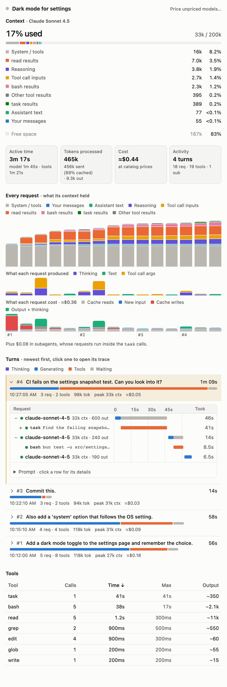

# opencode-viewer

A live dashboard of the current OpenCode session, in a tab of OpenCode Desktop's side region.

<picture>
  <source media="(prefers-color-scheme: dark)" srcset="docs/screenshot-dark.png">
  
</picture>

- **Context**: what fills the model's window: system prompt, your messages, reasoning, tool results, and free space.
- **Overview**: active time, tokens processed (and how much was cached), cost, and turns, requests and tool calls.
- **Every request**: what each request's context held, what it produced, and what it cost.
- **Turns**: a trace waterfall per prompt, with requests, tool calls and subagents you can expand.
- **Tools**: calls, time and output per tool.

It updates live and works for remote (SSH) sessions too.

## Quickstart

Requires OpenCode Desktop 2.2.5+.

```sh
git clone https://github.com/koaning/opencode-viewer && cd opencode-viewer
bun install && bun run build
```

Add the checkout to `~/.config/opencode/opencode.json` and restart OpenCode Desktop:

```jsonc
{
  "plugins": [{ "package": "/path/to/opencode-viewer" }],
}
```

Open it from the side region's **+** menu → **Session dashboard**, with `/dashboard`, or with <kbd>Cmd</kbd>+<kbd>Shift</kbd>+<kbd>D</kbd>.

Models without a price (e.g. Ollama) can be costed as another model via **Price unpriced models…** in the header.

## Develop

```sh
bun run dev         # rebuild on save
bun run typecheck
bun test
bun run screenshot  # regenerate docs/screenshot-*.png from a made-up session
```
